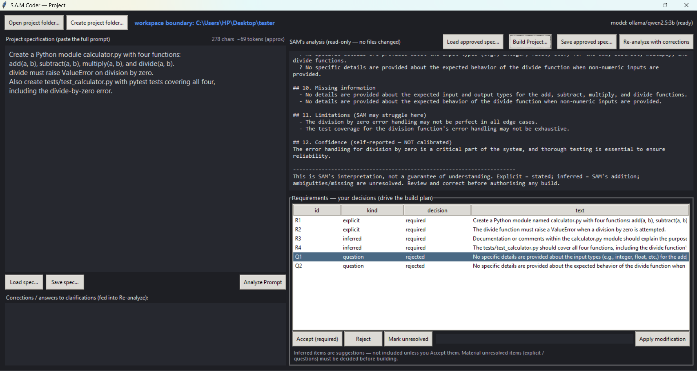
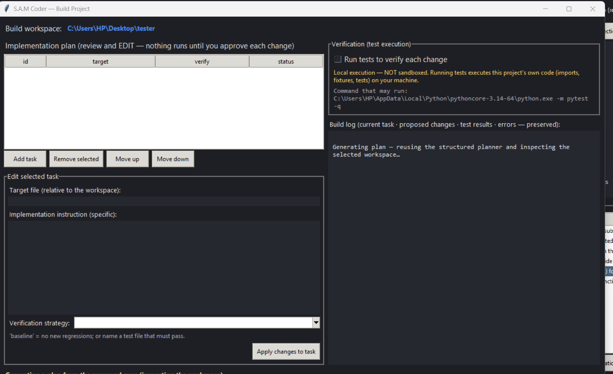
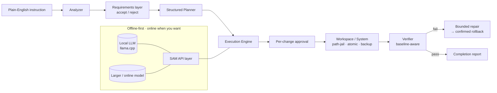

# S.A.M — A Personal AI Agent

> **Codes software today. Sees, searches, and acts tomorrow.**
> A private AI agent built from scratch — **offline-first, online when you want**. It plans, writes, and **verifies** real software now, and is growing into a full computer-operating agent that sees, reasons, searches, and gets things done (eyes · brain · hands).

---

## What it is

**S.A.M** is a private AI agent you fully own — runs on your own machine, offline-first, and connects to larger online models only when *you* choose. You describe what you want in plain English; it extracts the requirements, plans the work, and builds it **one approved change at a time**, verifying each step before moving on.

The principle: **nothing is claimed as done until it's verified.** Reliability first, flash second.

---

## Screenshots

**Prompt analysis — requirements extracted, your decisions drive the build:**

**Build Project — plan, approve each change, verify:**

---

## Built in two stages

| Stage | What it does | State |
|---|---|---|
| **① SAM Coder** | Turns plain English into working, **verified** multi-file software | ✅ **Built & tested** |
| **② SAM Agent** | Sees, reasons, **searches, finds, and acts** to complete tasks for you | 🚧 **In development** |

---

## Key features (SAM Coder)

- 🧠 **Structured planner** — turns a spec into an ordered, dependency-aware task plan.
- ✅ **Deterministic requirements layer** — separates what *you stated* from what the model *inferred*; you accept/reject each before any build.
- 🔒 **Per-change approval** — every file edit is shown as a diff and applied only on your approval.
- 🧪 **Baseline-aware verification** — distinguishes *new* failures from pre-existing ones; scoped test runs with full-suite fallback.
- ↩️ **Bounded self-repair + confirmed rollback** — a failed change is automatically undone and verified against disk.
- 💾 **Save & resume builds**, 🗂️ **repo indexing & impact analysis**, 🛡️ **safe by default** (execution off unless enabled; path-jail, atomic writes, backups).

---

## Where it's going (SAM Agent)

The same reliability harness, extended beyond the editor to the whole machine and the web:

- 👁️ **Eyes** — perceive the screen, the web, and application state.
- 🧠 **Brain** — plan multi-step tasks from one plain-English instruction (offline or online).
- 🔎 **Search & find** — look things up on the web, gather what it needs, decide the next step.
- ✋ **Hands** — act: navigate, click, type, and complete real workflows end to end — each step verifiable and reversible.

---

## Architecture

**The harness is the product; the model is a swappable engine.**

---

## Tech stack

`Python` · `llama.cpp` (local inference) · custom API layer · `tkinter` desktop GUI · `pytest` (424 automated tests)

---

## Status (honest)

- ✅ **Core engine + harness** — verified by **424 automated tests**.
- ✅ **Desktop GUI** — Analyze and Build workflows working.
- 🚧 **SAM Agent (see · search · act)** — in active development on the same harness.

Built solo, iteratively, with reliability prioritized over hype.

---

## Source code

Full implementation kept in a **private repository** to protect the work.
**Reviewers can be granted access on request** — contact below.

---

## Author

**Sahil Thakur** · [GitHub @Sarru991](https://github.com/Sarru991) · [Portfolio](https://sarru991.github.io)

---

## License

© 2026 Sahil Thakur. **All rights reserved.** Proprietary — see [`LICENSE`](LICENSE).
May not be copied, reused, modified, or redistributed without written permission.
